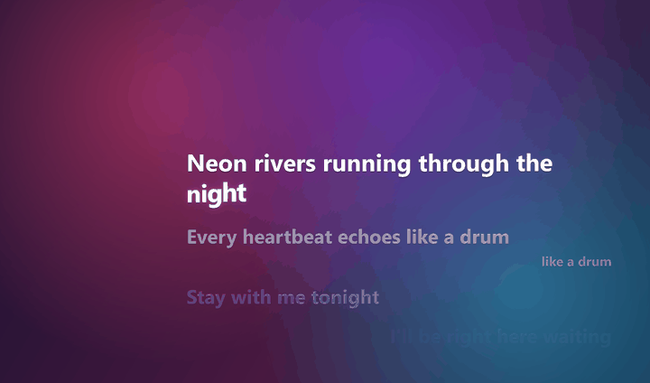
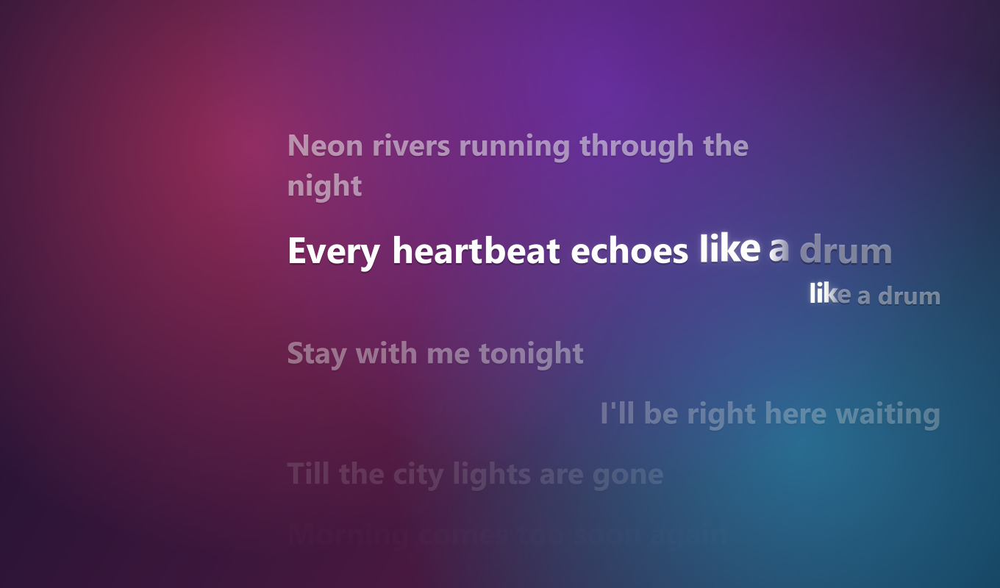
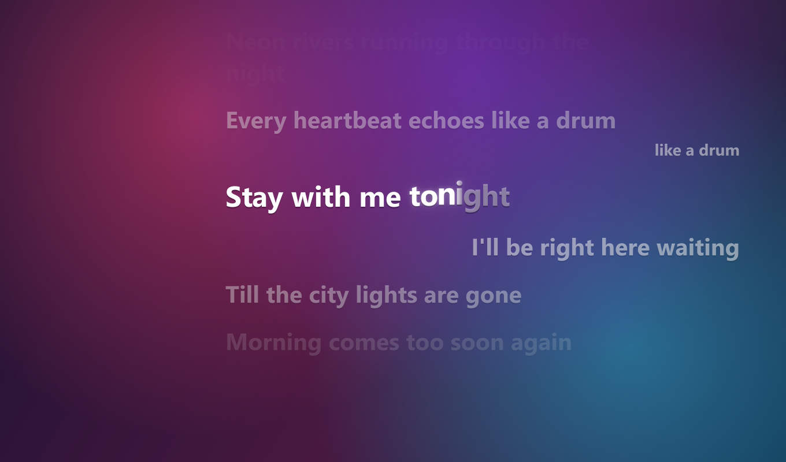
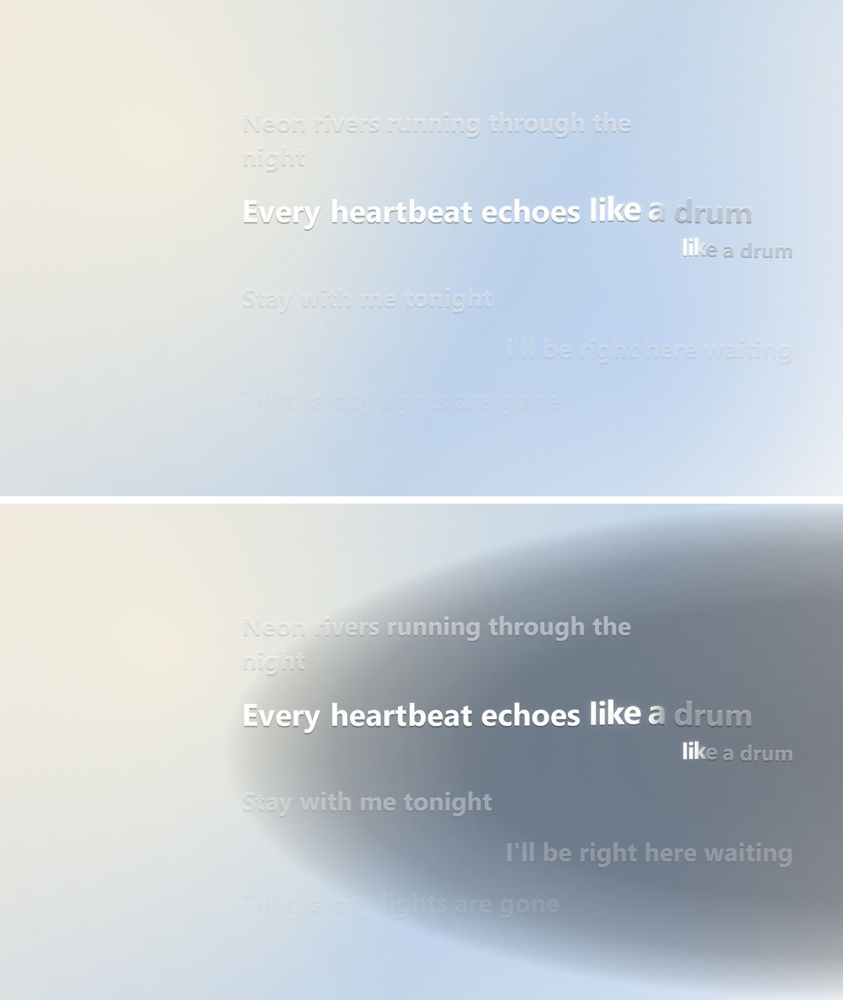
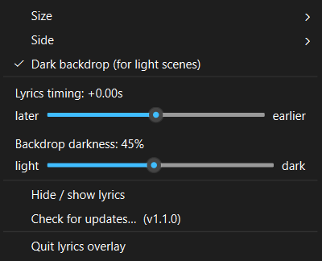

<div align="center">


# Lyrics Overlay

**Live, word-by-word synced lyrics from Spotify, floating over your game.**<br>
Click-through, always on top, and styled after Spicy Lyrics: letters swell in a wave as they're sung, ad-libs sing on the right, and instrumentals breathe with three little dots.

[**Download for Windows**](https://github.com/HayzDev/lyrics-overlay/releases/latest) · [How it works](#how-it-works) · [Build from source](#build-from-source)



</div>

---

## Features

<table>
<tr>
<td width="50%"></td>
<td width="50%"></td>
</tr>
<tr>
<td><b>Word and syllable timing.</b> A soft highlight sweeps through each letter, with a subtle bloom that follows the letters as they move. Ad-libs and background vocals sing at the same time, smaller, on the right. Duet partners get the right side too.</td>
<td><b>A wave that matches the singing.</b> Letters swell and lift as they're sung. On a fast line the wave is tight; on a long held note it stretches across the whole word.</td>
</tr>
<tr>
<td></td>
<td></td>
</tr>
<tr>
<td><b>Instrumental breaks.</b> Three dots fill across the gap. On long breaks the lyrics step aside, then the next lines fade in from the top just before the vocals come back.</td>
<td><b>Readable on bright scenes.</b> An optional dark haze that seems to drift in from the screen edge (no boxes), with adjustable darkness.</td>
</tr>
</table>

- **Never gets in the way.** The window is fully click-through and doesn't steal focus. Use your game in borderless or windowed mode.
- **No login.** It reads the current song and position from Windows' media controls, so there's nothing to connect or authorize. Works with Spotify and Spotifast.
- **Everything is in the tray.** Size (50–150%), screen side, timing offset, backdrop darkness, hide/show, and in-app updates.



## Install

1. Download `LyricsOverlay-Setup.zip` from the [latest release](https://github.com/HayzDev/lyrics-overlay/releases/latest) and unzip it.
2. Double-click **`Install.cmd`**.

That's it. It installs just for your user (no admin prompt), adds **Lyrics Overlay** to the Start menu and starts it. Play a song and the lyrics appear.

- **Update:** tray icon → *Check for updates…* It asks before installing anything, and keeps your settings.
- **Uninstall:** Settings → Apps → Lyrics Overlay → Uninstall.

## How it works

| | |
|---|---|
| **Now playing** | Windows *System Media Transport Controls*: the same data as the volume flyout. Title, artist and playback position, extrapolated smoothly between updates. |
| **Lyrics** | [Better Lyrics](https://github.com/boidushya/better-lyrics) API first (Apple Music TTML with syllable timing, background vocals and singers), then [LRCLIB](https://lrclib.net) (line timing, with word timing estimated from word length). |
| **Drawing** | PySide6 (Qt) with a translucent, input-transparent, always-on-top window. Every letter is drawn individually so it can swell, glow and sweep. |

> **Note:** Better Lyrics serves songs from its cache without a key, so very obscure tracks may fall back to LRCLIB's line timing.

## Build from source

Requires Windows and Python 3.12+.

```powershell
pip install PySide6 requests winrt-runtime winrt-Windows.Media.Control winrt-Windows.Foundation
python lyrics_overlay.py            # run it
python lyrics_overlay.py --selftest # parser checks
```

To build the installer (`release\` and `LyricsOverlay-Setup.zip`):

```powershell
pip install pyinstaller pillow
.\build.cmd
```

`python tools/screenshots.py` regenerates the images in `docs/`. They use original demo lyrics, not real songs.

Tuning constants (font, sizes, wave, bloom, fades) are at the top of [`lyrics_overlay.py`](lyrics_overlay.py). Settings and a log live in `%APPDATA%\LyricsOverlay\`.

## Credits

Inspired by [Spicy Lyrics](https://github.com/Spikerko/spicy-lyrics) for Spicetify. Lyrics from [Better Lyrics](https://github.com/boidushya/better-lyrics) and [LRCLIB](https://lrclib.net). Not affiliated with Spotify.

## License

[MIT](LICENSE)
